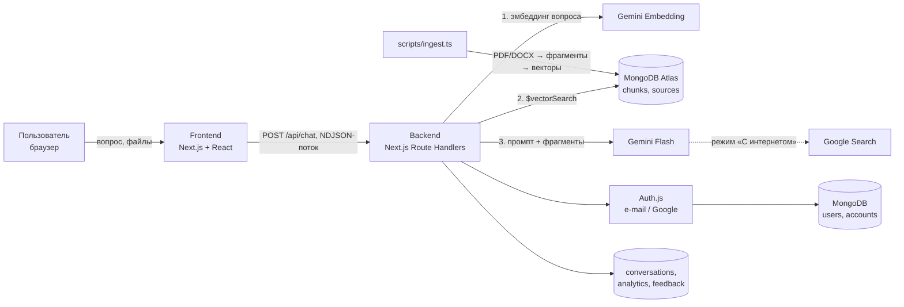

# Адал қоғам — ИИ-справочник по Конституции и государственной политике

Веб-платформа с искусственным интеллектом, которая отвечает на вопросы о Конституции Республики Казахстан, законах и государственной политике в сфере внутренней политики и идеологической работы. Ответы формируются **на основе официальных документов** на родном языке пользователя: **казахском, русском или английском**.

Проект создан для конкурса студенческих AI-проектов «Адал қоғам» (Центр общественного развития Управления внутренней политики г. Алматы, МУИТ).

---

## Проблема и решение

**Проблема.** Тексты Конституции и законов длинные, написаны сложным юридическим языком, а информация о ценностях и концепциях внутренней политики («Закон и Порядок», «Адал азамат», «Справедливый Казахстан» и др.) разбросана по разным источникам. Обычные чат-боты на LLM при этом «додумывают» ответы и ошибаются в номерах статей.

**Решение.** Интеллектуальный справочник-навигатор на архитектуре **RAG** (Retrieval-Augmented Generation):

1. официальные документы заранее разбиваются на фрагменты и сохраняются в векторной базе;
2. на каждый вопрос система находит близкие по смыслу фрагменты;
3. LLM формирует ответ **только по этим фрагментам** и указывает документ, статью и ссылку на эталонный текст в «Әділет»;
4. если подходящих фрагментов нет, **модель вообще не вызывается** и бот честно говорит, что информации нет (п. 4.9 Положения).

Целевая аудитория: граждане, студенты, школьники, госслужащие, журналисты.

## Основные функции

| Функция | Описание |
|---|---|
| Ответы по официальным документам (RAG) | Векторный поиск в MongoDB Atlas + Gemini, ссылки на источник и статьи |
| Два режима работы | «По документам» (по умолчанию, максимальная точность) и «С интернетом» (Google Search, с предупреждением о сниженной точности) |
| Три языка | Интерфейс и ответы на казахском, русском и английском. Ответ на языке вопроса |
| Регистрация и вход | По e-mail и паролю или через Google (GitHub опционально). Гостевой режим без регистрации |
| История диалогов | Для вошедших пользователей диалоги сохраняются в MongoDB, доступны с любого устройства |
| Работа с файлами и фото | PDF, DOCX, TXT, MD и фото (JPEG/PNG/WebP/HEIC): бот анализирует их и сверяет с базой |
| Голос | Голосовой ввод вопроса (ru-RU / kk-KZ / en-US) и озвучивание ответа |
| Оценка ответов | 👍 / 👎 под каждым ответом для контроля качества |
| Аналитика | Страница `/stats` для администраторов: запросы, режимы, языки, доля «нет в базе», удовлетворённость, время ответа |
| Страница «О проекте» | Как работает бот, список документов базы со ссылками на adilet.zan.kz |
| Обработка ошибок | Понятные сообщения при сбоях сети, перегрузке модели, лимитах, неверных файлах; кнопка «Повторить» |
| Потоковый ответ | Текст появляется в реальном времени, генерацию можно остановить |

## Архитектура



**Поток запроса** (`src/app/api/chat/route.ts` → `src/lib/chat-engine.ts`):

1. Проверка лимита запросов (MongoDB, по пользователю или хэшу IP).
2. Валидация тела запроса (zod) и вложений (тип определяется по содержимому файла, а не по расширению).
3. Векторный поиск: вопрос → эмбеддинг `gemini-embedding-001` (768 измерений) → `$vectorSearch` → фрагменты выше порога `RAG_MIN_SCORE`.
4. В режиме «По документам» без найденных фрагментов модель не вызывается: возвращается готовый ответ «в базе нет информации».
5. Системный промпт (`src/lib/prompts.ts`) с правилами: только факты из фрагментов, ссылки на документы, пометка «Закреплено в Конституции», ответ на языке вопроса, защита от prompt-injection во фрагментах и файлах.
6. Потоковая генерация Gemini, события `sources` / `delta` / `error` / `done` в формате NDJSON.
7. Обезличенная запись метрик в `analytics`.

**Загрузка знаний** (`scripts/ingest.ts`): PDF/DOCX/TXT/MD из `data/documents` → извлечение текста → разбиение на фрагменты по статьям и главам (`src/lib/chunker.ts`) → эмбеддинги → MongoDB. Неизменённые файлы пропускаются по хэшу.

### Структура проекта

```
data/documents/          официальные документы + manifest.json (название, тема, язык, ссылка на adilet)
messages/{ru,kk,en}.json  тексты интерфейса на трёх языках
scripts/                 загрузка документов, создание индексов, проверка поиска
src/app/[locale]/        страницы: чат, вход, «О проекте», аналитика
src/app/api/             chat, conversations, feedback, health, auth
src/components/chat/     чат: ввод, сообщения, источники, режимы, история
src/lib/                 логика: RAG, промпты, Gemini, авторизация, аналитика, голос
src/proxy.ts             маршрутизация языков (в Next.js 16 middleware называется proxy)
```

### Коллекции MongoDB

| Коллекция | Назначение |
|---|---|
| `chunks` | Фрагменты документов с векторами (`embedding`), индекс `chunks_vector_index` |
| `sources` | Загруженные документы и их хэши |
| `users`, `accounts` | Пользователи (Auth.js). Для входа по почте хранится `passwordHash` (scrypt) |
| `conversations` | История диалогов (только у вошедших) |
| `analytics` | Обезличенные метрики запросов, удаляются через 180 дней |
| `feedback` | Оценки ответов 👍/👎, удаляются через 180 дней |
| `rate_limits` | Счётчики лимитов запросов (TTL) |

## Технологии

| Слой | Технологии |
|---|---|
| Frontend | Next.js 16 (App Router), React 19, TypeScript, Tailwind CSS 4, shadcn/ui (Radix), Framer Motion, react-markdown |
| Backend | Next.js Route Handlers и Server Actions (Node.js runtime) |
| AI | Google Gemini (`@google/genai`): чат-модель Flash, `gemini-embedding-001`, инструмент Google Search |
| База данных | MongoDB Atlas + Atlas Vector Search |
| Авторизация | Auth.js v5 (`next-auth`): Credentials (e-mail + пароль), Google, GitHub; `@auth/mongodb-adapter` |
| Мультиязычность | next-intl (ru, kk, en) |
| Голос | Web Speech API браузера (распознавание и синтез речи) |
| Валидация | zod |
| Документы | pdf-parse, mammoth (DOCX) |

### Внешние API

- **Google Gemini API** — генерация ответов, эмбеддинги, поиск Google в режиме «С интернетом».
- **MongoDB Atlas** — хранение данных и векторный поиск.
- **Google OAuth / GitHub OAuth** — вход через внешние аккаунты.

## Запуск

Требования: **Node.js 20+**, аккаунт MongoDB Atlas (бесплатный кластер M0 подходит), ключ Gemini API.

```bash
# 1. Установить зависимости
npm install

# 2. Настроить переменные окружения
cp .env.example .env.local      # и заполнить значения

# 3. Создать индексы (векторный индекс, уникальность e-mail, TTL)
npm run db:index

# 4. Загрузить документы из data/documents в базу знаний
npm run ingest                  # --force, чтобы пересчитать всё

# 5. Запустить
npm run dev                     # http://localhost:3000
```

Проверка поиска без интерфейса (помогает подобрать `RAG_MIN_SCORE`):

```bash
npm run search -- "Как избирается Президент?"
```

Продакшн-сборка: `npm run build && npm start`. Проект готов к деплою на Vercel (переменные окружения задаются в настройках проекта; в Google OAuth нужно добавить redirect URI `https://<домен>/api/auth/callback/google`).

Проверка работоспособности: `GET /api/health` возвращает состояние базы и наличие ключа Gemini.

### Как добавить документ в базу знаний

1. Положить файл (PDF с текстовым слоем, DOCX, TXT или MD) в `data/documents/`.
2. Добавить запись в `data/documents/manifest.json`: `title`, `topic`, `lang`, `url` (ссылка на официальный текст).
3. Выполнить `npm run ingest`.

## Безопасность и надёжность

- Ключи API, пароли и токены только в `.env.local` (не попадает в git); в репозитории лишь `.env.example`.
- Пароли хранятся как хэш **scrypt** с солью, сравнение за постоянное время; защита от перебора: не более 10 попыток входа на e-mail за 5 минут.
- Лимиты запросов к чату, сохранению истории и оценкам (MongoDB, работает и на serverless).
- Валидация всех входных данных (zod), проверка типа файлов по сигнатуре, ограничения размера.
- Защита от prompt-injection: фрагменты, файлы и веб-страницы помечены в промпте как данные, а не команды.
- Доступ к диалогам только владельцу (фильтр по `userId` на сервере); защита от открытых редиректов при входе.
- Заголовки безопасности: `X-Frame-Options`, `nosniff`, HSTS, `Permissions-Policy`, CSP `frame-ancestors`.
- Персональные данные: аналитика обезличена (тексты вопросов не сохраняются, IP хранится только как хэш в счётчиках лимитов).
- Отказоустойчивость: автоматическое переключение на резервную модель Gemini (`GEMINI_FALLBACK_MODELS`), если основная перегружена (503/429) или не начала отвечать за 15 с; гостевой режим при недоступности авторизации, режим «С интернетом» продолжает работу, если база недоступна.

## Соответствие требованиям Положения

| Требование | Реализация |
|---|---|
| 4.1 Справочник-навигатор, ссылки на первоисточник, пометка о Конституции | RAG по официальным документам, ссылки на adilet.zan.kz, правило «Закреплено в Конституции» в промпте |
| 4.3 Платформа | Web-интерфейс (адаптивный, работает на телефоне) |
| 4.4 LLM | Google Gemini |
| 4.6 Естественный язык, реальное время, ошибки, интерфейс, kk + ru | Потоковые ответы, обработка ошибок, три языка |
| 4.7 RAG | MongoDB Atlas Vector Search + Gemini Embedding |
| 4.8–4.9 Проверенные источники, без выдумок | Режим «По документам» по умолчанию, модель не вызывается без найденных фрагментов |
| 4.10 Бонусы | Голос, изображения, авторизация, интеграции (Google Search, OAuth), аналитика, персонализация (история) |
| 6.3 Репозиторий | README, инструкция по запуску, технологии, зависимости и API, архитектура |
| 6.4 / 13.2 Секреты | `.env.local` в `.gitignore`, `.env.example` без значений |

## Информационные источники

Официальные тексты (Информационно-правовая система нормативных правовых актов РК «Әділет», adilet.zan.kz):

- Конституция Республики Казахстан (принята на республиканском референдуме 15 марта 2026 года)
- Конституционный закон «О государственных символах Республики Казахстан»
- Конституционный закон «О судебной системе и статусе судей Республики Казахстан»
- Конституционный закон «О выборах в Республике Казахстан»
- Конституционный закон «О Конституционном Суде Республики Казахстан»
- Конституционный закон «Об Уполномоченном по правам человека в Республике Казахстан»

Полный список с метаданными — `data/documents/manifest.json`.

При разработке использовались AI-ассистенты (в т. ч. Claude) для написания и проверки кода и подготовки документации, что разрешено п. 7.1 Положения. Команда понимает и может объяснить все части проекта.
